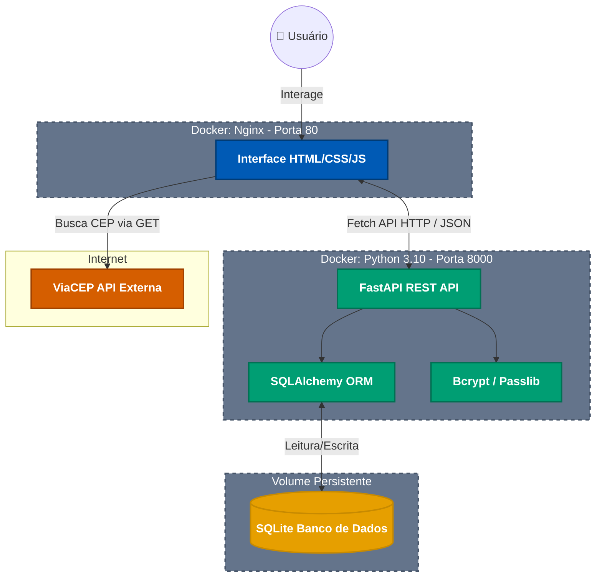

> # Meu Front

Este projeto vialibiza a parte da Disciplina **Arquitetura de Software** do curso de Engenharia de Software da PUC-Rio

Projeto volta para a criação inicial de site, onde o objetivo foi desenvolver um sistema de cadastro de usuário, onde e inserido os dados e consumidi pela API desenvolvida, e para o registro do CEP e consumido os dados da API externa https://viacep.com.br/ que após inserir o numero do CEP o endereço e preenchido de forma automatica

---
> ## 🛠️ Tecnologias Utilizadas
* **HTML5 & CSS3:** Estruturação semântica e estilização avançada.
* **JavaScript (Vanilla):** Manipulação do DOM e consumo de APIs via `Fetch API`.
* **Integração Externa (ViaCEP):** Preenchimento automático de endereços a partir do CEP.
* **Acessibilidade:** Paleta de cores **Okabe-Ito**, otimizada para pessoas com daltonismo, e mensagens de feedback claras.
* **Docker & Nginx:** Servidor web ultraleve para hospedagem de arquivos estáticos.

> ## 🚀 Funcionalidades
* **Single Page Application (SPA):** Toda a interação ocorre sem recarregar a página.
* **Orquestração de Dados:** O frontend agrupa o endereço na memória e envia chamadas sequenciais precisas ao backend.
* **Busca Dinâmica:** Pesquisa rápida por nome ou e-mail na lista de clientes.
* **Feedback Visual:** Alertas não intrusivos de erro e sucesso, remoção de `alerts` nativos do navegador.
* **Segurança Visual:** Campo de senha com função de Mostrar/Ocultar (Toggle Eye) e placeholders dinâmicos durante a edição.

> ## 📦 Como rodar localmente

Por se tratar de arquivos estáticos, você pode rodar o projeto de duas formas:
1. Abrindo diretamente o arquivo `index.html` no seu navegador.
2. Utilizando a extensão **Live Server** no VS Code (recomendado).

> ## 🐳 Como rodar com Docker (Nginx)
```bash
docker build -t app-frontend .
docker run -d -p 80:80 app-frontend

OBS: Para executar o projeto de forma orquestrada pelo docker compose, criar o arquivo **docker-compose.yml** na raiz principal do projeto adicionar o payload abaixo, e depois executar o comando docker compose up --build no terminal ele vai criar a imagem do front e do back do docker desktop usando os arquivos Dockerfile criado na pasta do back e do front, e importante o docker desktop estar aberto

Adicionar no arquivo docker-compose.yml:

version: '3.8'

services:
  backend:
    build: ./back
    container_name: app_backend
    ports:
      - "8000:8000"
    volumes:
      - ./back:/app  # Mantém o banco de dados SQLite sincronizado com sua máquina local
    restart: always

  frontend:
    build: ./front
    container_name: app_frontend
    ports:
      - "80:80"
    depends_on:
      - backend
    restart: always

```
**link do front: http://localhost/**


> ## Diagrama da Arquitetura do Projeto



> ## Como funciona a arquitetura ilustrada acima:
```
O usuário acessa o site carregado pelo Nginx (Frontend).

Ao digitar um CEP, o JavaScript no frontend faz uma requisição direta e externa à API do ViaCEP para preencher o formulário.

Ao submeter o formulário, o Frontend orquestra pacotes em JSON e envia para a API FastAPI (Backend).

O Backend valida as regras, usa o Bcrypt para transformar a senha em Hash, e passa os dados para o SQLAlchemy (ORM).

O SQLAlchemy salva a relação entre Usuário e Endereço no arquivo .db do SQLite.
```